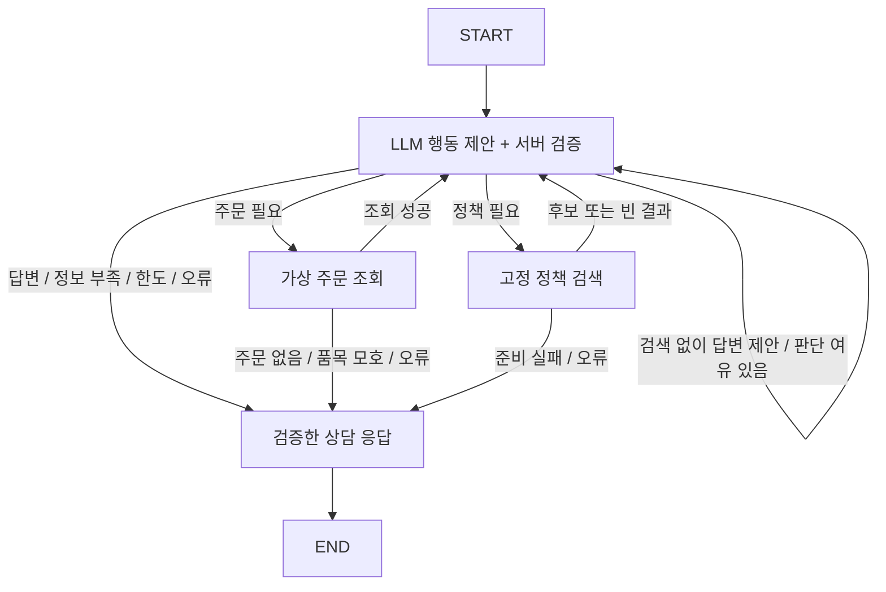

# 3일차 · 기본 상담 그래프

2026-10-30 구현 기준이다. 주문·정책을 실행하는 도구는 기존 lookup_order와 search_policy 두 개다. 실제 취소·환불·발송과 로그인·멀티 에이전트는 없다.

## 역할과 흐름



LangChain은 ChatOpenAI의 구조화 출력과 두 @tool 인터페이스를 제공한다. 이번 모델은 NextAction JSON으로 lookup_order/search_policy/finish 중 행동과 최종 답변 제안을 반환한다. 서버가 제안을 검증한 뒤 LangChain 도구의 invoke를 호출한다. OpenAI의 native tool_calls를 그대로 실행하는 방식과 구분한다.

LangGraph StateGraph가 상태와 조건 분기를 관리한다. 그래프 안에 create_agent/AgentExecutor나 별도 에이전트 반복 실행기를 중첩하지 않는다. 모델이 선택하는 것은 조회 필요 여부·검색어·재검색·답변 충분성이다. 서버가 고정하는 것은 입력 검증·명시한 주문번호만 조회·횟수 상한·실제 결과 보존·오류 종료·인용 ID 검사다.

## 상태

app/agent/models.py의 AgentState에 요청·request_id·reference_time, 실제 order_result, 검색 sources, tool_events, llm_calls, 누적 requires_order, 서버 feedback, 현재 decision과 최종 response를 둔다. 노드는 부분 dict를 반환해 상태를 갱신한다. 목록도 기존 목록을 포함한 새 목록으로 교체하며 별도 누적 reducer는 없다. 요청마다 초기 상태를 만들고 체크포인트·채팅 이력을 저장하지 않는다.

입력한 주문번호는 상담원이 이번 문의 대상으로 선택한 주문으로 취급한다. 따라서 order_id가 있으면 초기 requires_order=true로 두고, 모델이 일반 정책으로 분류하더라도 해당 주문을 먼저 조회한다. 순수 일반 정책 문의는 번호를 비워서 보낸다. 주문이 필요하다고 기록된 뒤에는 false로 되돌아가지 않는다. 번호가 필요한데 없으면 추가 확인으로, 번호는 있으나 조회 전이면 서버가 먼저 조회 경로로 보낸다. 모델 출력에는 주문 객체나 출처 URL 필드가 없어 실제 결과를 대체할 수 없다. 다만 자유 문장에 대한 의미적 오류까지 타입만으로 보장하지 않는다.

검색 없이 answered를 제안하면 남은 모델 판단 한도 안에서 feedback과 함께 판단 노드로 되돌린다. 도구 실행을 만들어내거나 검색어를 서버가 대신 고치지는 않는다. 여전히 검색을 하지 않으면 마지막에 근거 부족으로 종료한다. 근거 부족 상태의 추천만 null인 경우에는 정책 규정 대신 고정된 추가 확인 절차로 보완한다. 잘못된 인용 등 다른 검증은 그대로 적용한다. 진단용 오류 필드는 원시 입력 없이 서버/평가 보고서에만 남기고 고객 응답에는 내부 오류를 노출하지 않는다.

최종 조립에서 모델이 insufficient_evidence를 제안하면서 구체적인 missing_fields를 함께 냈다면 needs_information을 우선한다. 기존 질문·조회 사실·정책·추천 내용은 보존하며 서버가 질문을 새로 만들지 않는다. 확인 질문이 없으면 근거 부족 상태를 유지하고, 인용 등 다른 검증은 계속 적용한다. 이는 응답 조립 규칙이며 기존 보고서/공개 스키마를 소급 수정하지 않는다.

## 실행 제한과 종료

| 조건 | 동작 |
|---|---|
| 주문 조회 | 최대 1회, 요청에 명시한 번호만 사용 |
| 정책 검색 | 최대 2회: 최초 + 재검색 1회 |
| 전체 도구 | 최대 3회, 실행 직전에 차단 |
| 모델 판단 | 최대 4회, 호출별 30초·SDK 재시도 0회 |
| 그래프 재귀 | 보조 한도 16단계. 도구/모델 횟수와 별개 |
| 없는 주문 | order_not_found, 조회 결과 유지 |
| 주문번호·품목·상태·수령일 부족 | needs_information과 확인 항목 |
| 근거 없이 answered 제안 | insufficient_evidence로 종료 |
| 존재하지 않는 인용·초안 누락 | system_error, 고객 초안 숨김 |
| 모델/조회/검색 오류 또는 검색 미준비 | system_error. 주문 없음·근거 없음으로 숨기지 않음 |

sources는 실제 검색 결과의 ID로 합치고 recommendation/applied_policies/tool_events의 인용을 검사한다. 검색 후보가 존재한다는 이유만으로 답변 가능한 것으로 보지 않는다. 후보의 실제 의미와 적용 충분성은 모델 판단과 사람이 읽는 평가가 필요하다.

## 실행과 비용 설정

기본 .env.example은 AGENT_ALLOW_API=false, RAG_ALLOW_API=false다. 실제 상담하려면 로컬 .env에서 두 값을 true로 설정하고 백엔드를 재시작한다. 키는 서버 OPENAI_API_KEY만 사용하고 프런트로 보내지 않는다. 정책 인덱스가 없으면 먼저 `python -m scripts.rag restore`로 복원한다. 복원은 무료지만 새로운 질문의 임베딩·모델 판단은 API를 사용한다.

API 비활성에서도 POST /api/consultations는 200 응답의 system_error로 종료한다. Health의 ai_enabled는 서버 허용/키 설정 여부이며 네트워크나 모델의 실제 가용성을 보장하지 않는다. 환경변수 로딩은 캐시되므로 .env 변경 후 재시작한다.

고정 기준일의 소규모 실제 검증:

```powershell
.\.venv\Scripts\python.exe -X utf8 -m scripts.smoke_agent --allow-api
```

기본 4사례, 최대 6사례이며 `.env`를 수정하지 않는다. 기준일은 평가 자료의 2026-10-22T12:00:00+09:00을 내부로 주입한다. 실제 API의 기준 시각은 현재 시각이며 클라이언트가 바꿀 수 없다. [실제 검증 보고서](day3-agent-smoke.json), [범위·한계](devlog/day03-2026-10-30.md)

참고한 공식 문서: [LangGraph Graph API](https://docs.langchain.com/oss/python/langgraph/graph-api), [ChatOpenAI](https://docs.langchain.com/oss/python/integrations/chat/openai), [OpenAI 구조화 출력](https://developers.openai.com/api/docs/guides/structured-outputs). 기존 잠금 버전을 유지했고 새 패키지는 추가하지 않았다.
